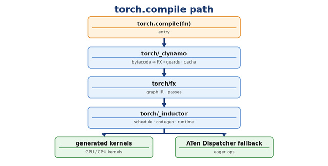
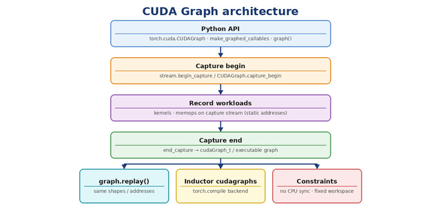
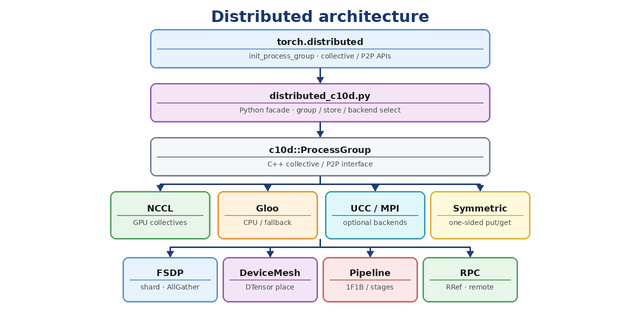
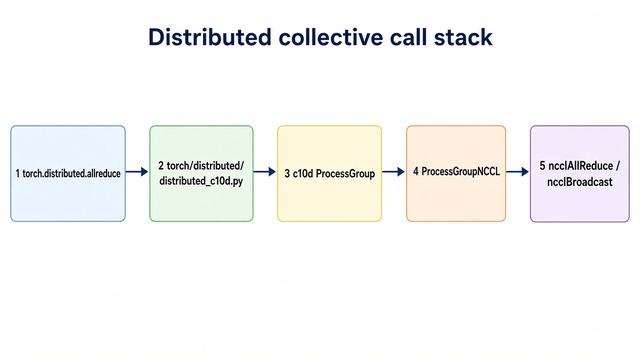

# pytorch-basic-learning

Source-oriented architecture diagrams for how PyTorch is put together — from
Python APIs through bindings, ATen / c10, the Dispatcher, compile, CUDA Graphs,
and distributed runtimes.

Path names refer to a normal upstream PyTorch tree (`torch/`, `torch/csrc/`,
`aten/`, `c10/`). Deeper notes and small cases live under [`modules/`](modules/).

## Contents

- [1. Overall architecture](#1-overall-architecture)
- [2. torch.compile](#2-torchcompile)
- [3. Dispatcher & backends](#3-dispatcher--backends)
- [4. CUDA Graph](#4-cuda-graph)
- [5. Distributed](#5-distributed)

---

## 1. Overall architecture

Python → Compile (`_dynamo` / `fx` / `_inductor`) → Bridge → Libs (c10 / ATen) → Runtime.

| Tree | Role |
| --- | --- |
| `torch/` | Python API + compile (`_dynamo` / `_inductor` / `fx`) |
| `torch/csrc/` | C++ bindings, autograd, c10d, JIT, CUDA helpers |
| `aten/` | Op schemas, Dispatcher, `native` / CUDA / cuDNN kernels |
| `c10/` | `TensorImpl`, `DispatchKey`, CUDA allocator / stream / guard |
| `torchgen/` | Codegen from YAML |

---

## 2. torch.compile

`torch.compile(fn)` → `_dynamo` → `fx` → `_inductor` → generated kernels, with ATen Dispatcher fallback.

Module: [`modules/compile`](modules/compile/)

---

## 3. Dispatcher & backends

Eager ops go through the Dispatcher. Kernels are selected by **DispatchKey** /
**DispatchKeySet** (`c10/core/DispatchKey.h`).

Module: [`modules/c10_aten`](modules/c10_aten/) · notes: [`docs/dispatcher/overview.md`](docs/dispatcher/overview.md)

---

## 4. CUDA Graph

Capture a static GPU workload once (`CUDAGraph` / `make_graphed_callables`), then
`replay()`; Inductor may emit cudagraphs under `torch.compile`.

Module: [`modules/cudagraph`](modules/cudagraph/)

---

## 5. Distributed

`torch.distributed` → c10d `ProcessGroup` → NCCL / Gloo / …, plus higher-level
FSDP / DeviceMesh / Pipeline / RPC patterns.

Module: [`modules/distributed`](modules/distributed/)
