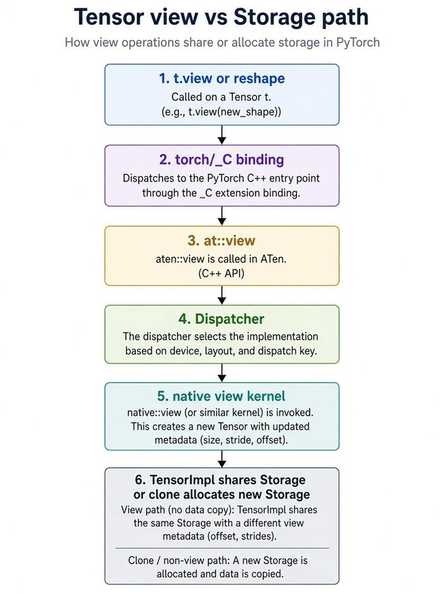
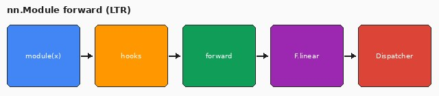
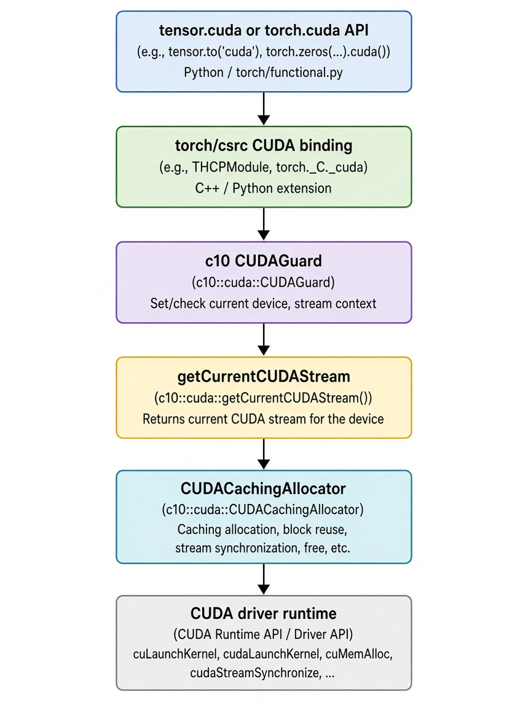

# pytorch-basic-learning

Map PyTorch **source layout**, **dispatcher / backends**, and **module call stacks** with small cases under `modules/`.

Figures: [`docs/figures/`](docs/figures/) (display width **640px**). Upstream paths mean a normal PyTorch tree (`torch/`, `aten/`, `c10/`).

---

## 1. Architecture


| Layer | Path |
| --- | --- |
| Python | `torch/**` |
| Compile | `_dynamo` → `fx` → `_inductor` |
| Bridge | `torch/_C` ← `torch/csrc` |
| Libs | `ATen` (ops + Dispatcher) · `c10` (Tensor/Storage/Device/allocator) |
| Runtime | CUDA / NCCL / drivers |


---

## 2. Source map (short)

| Tree | Role |
| --- | --- |
| `torch/` | Python API + compile (`_dynamo` / `_inductor` / `fx`) |
| `torch/csrc/` | C++ bindings, autograd, c10d, JIT, CUDA helpers |
| `aten/` | Op schemas, Dispatcher, `native` / CUDA / cuDNN kernels |
| `c10/` | `TensorImpl`, `DispatchKey`, CUDA allocator / stream / guard |
| `torchgen/` | Codegen from YAML |

<details>
<summary>Directory cheat-sheet</summary>

**Python:** `nn/`, `autograd/`, `cuda/`, `distributed/`, `optim/`, `jit/`, `export/`, `fx/`, `_dynamo/`, `_inductor/`, `_dispatch/`  
**csrc:** `autograd/`, `cuda/`, `distributed/c10d/`, `jit/`, `dynamo/`, `inductor/`  
**ATen/c10:** `ATen/core/dispatch/`, `ATen/native(/cuda|/cudnn|/transformers)/`, `c10/core/`, `c10/cuda/`

</details>

---

## 3. Dispatcher & backends

Eager ops go through the Dispatcher. Kernels are selected by **DispatchKey** / **DispatchKeySet** (`c10/core/DispatchKey.h`).


| Idea | Detail |
| --- | --- |
| Register | each `aten::op` has a table of kernels keyed by DispatchKey |
| Select | compute key set from args; pick highest-priority key |
| Redispatch | wrap keys (Autograd / Functionalize / …) peel themselves and call again |
| Backend | final key → CPU / CUDA / MPS / XPU / PrivateUse1 / … implementation |


More notes: [`docs/dispatcher/overview.md`](docs/dispatcher/overview.md).

---

## 4. Module call stacks

| Tensor · [`modules/tensor`](modules/tensor/) | Autograd · [`modules/autograd`](modules/autograd/) |
| --- | --- |
|  |  |

| NN · [`modules/nn`](modules/nn/) | CUDA · [`modules/cuda`](modules/cuda/) |
| --- | --- |
|  |  |

**Distributed** · [`modules/distributed`](modules/distributed/) — `collectives/`, `symmetric/`, plus FSDP / mesh / pipeline / RPC / checkpoint notes


**Compile / Export / c10_aten:** §1 compile figure; [`modules/export`](modules/export/); [`modules/c10_aten`](modules/c10_aten/) (DispatchKey dump case).

---

## 5. Cases

| Module | Entry |
| --- | --- |
| `modules/tensor` | `case_view_copy.py`, `case_stride_contiguity.py` |
| `modules/autograd` | `case_custom_function.py`, `case_grad_fn_chain.py` |
| `modules/nn` | `case_linear_forward.py`, `case_state_dict.py` |
| `modules/cuda` | `case_stream_mem.py`, `case_peer_access.py` |
| `modules/c10_aten` | `case_dispatch_dump.py` |
| `modules/distributed/collectives` | `./run_allreduce.sh` (8 GPUs) |
| `modules/distributed/symmetric` | `./run_put_get.sh` (2 GPUs, P2P) |
| `modules/compile` | `case_compile_basic.py` |
| `modules/export` | `case_export_basic.py` |

```bash
git clone git@github.com:HangJie720/pytorch-basic-learning.git
cd pytorch-basic-learning/modules/tensor && python case_view_copy.py
```
