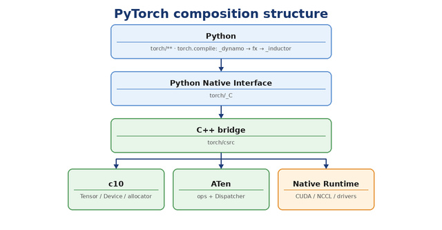
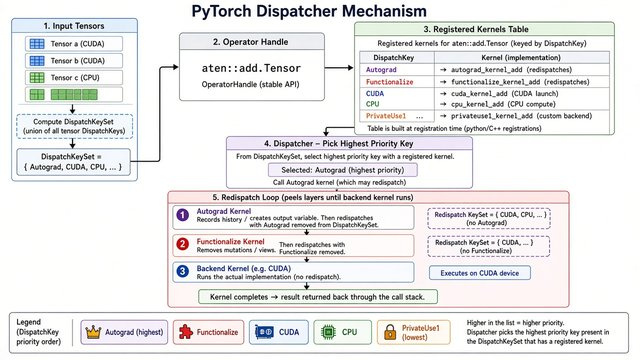
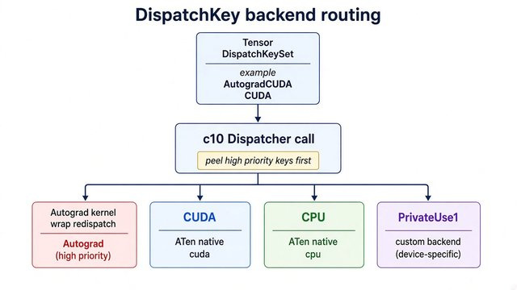
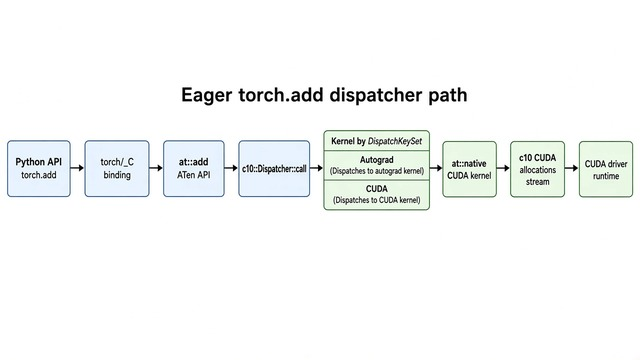

# pytorch-basic-learning

This repo is a **source-oriented** guide to how PyTorch is put together and how a single op actually runs — from Python API down through bindings, ATen / c10, the Dispatcher, and into CUDA / NCCL backends.

It is meant for people who already use `torch` day to day and want a clearer mental model of the tree (`torch/`, `torch/csrc/`, `aten/`, `c10/`), not another high-level tutorial. Each topic pairs a short call-stack narrative with a small runnable case under `modules/`, so you can jump from diagram → code path → experiment.

Focus areas:

- **Architecture & source map** — layered tree plus where each piece lives upstream
- **Dispatcher & backends** — how `DispatchKey` / `DispatchKeySet` select and redispatch kernels (CPU / CUDA / PrivateUse1 / …)

Path names in the notes refer to a standard upstream PyTorch source tree. Deeper per-module notes and cases live under [`modules/`](modules/).

## Contents

- [1. Architecture & source map](#1-architecture--source-map)
- [2. Dispatcher & backends](#2-dispatcher--backends)
- Modules
  - [tensor](modules/tensor/)
  - [autograd](modules/autograd/)
  - [nn](modules/nn/)
  - [cuda](modules/cuda/)
  - [c10_aten](modules/c10_aten/)
  - [distributed](modules/distributed/)
    - [collectives](modules/distributed/collectives/)
    - [symmetric](modules/distributed/symmetric/)
  - [compile](modules/compile/)
  - [export](modules/export/)

---

## 1. Architecture & source map

One tree: **Python → Compile (`_dynamo` / `fx` / `_inductor`) → Bridge → Libs (c10 / ATen) → Runtime**, with compile falling back into the Dispatcher when needed.

| Tree | Role |
| --- | --- |
| `torch/` | Python API + compile (`_dynamo` / `_inductor` / `fx`) |
| `torch/csrc/` | C++ bindings, autograd, c10d, JIT, CUDA helpers |
| `aten/` | Op schemas, Dispatcher, `native` / CUDA / cuDNN kernels |
| `c10/` | `TensorImpl`, `DispatchKey`, CUDA allocator / stream / guard |
| `torchgen/` | Codegen from YAML |

Directory cheat-sheet

**Python:** `nn/`, `autograd/`, `cuda/`, `distributed/`, `optim/`, `jit/`, `export/`, `fx/`, `_dynamo/`, `_inductor/`, `_dispatch/`  
**csrc:** `autograd/`, `cuda/`, `distributed/c10d/`, `jit/`, `dynamo/`, `inductor/`  
**ATen/c10:** `ATen/core/dispatch/`, `ATen/native(/cuda|/cudnn|/transformers)/`, `c10/core/`, `c10/cuda/`

---

## 2. Dispatcher & backends

Eager ops go through the Dispatcher. Kernels are selected by **DispatchKey** / **DispatchKeySet** (`c10/core/DispatchKey.h`).

| Idea | Detail |
| --- | --- |
| Register | each `aten::op` has a table of kernels keyed by DispatchKey |
| Select | compute key set from args; pick highest-priority key |
| Redispatch | wrap keys (Autograd / Functionalize / …) peel themselves and call again |
| Backend | final key → CPU / CUDA / MPS / XPU / PrivateUse1 / … implementation |

More notes: [`docs/dispatcher/overview.md`](docs/dispatcher/overview.md).
