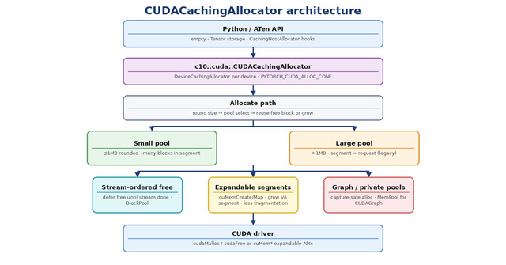

# allocator (`CUDACachingAllocator`)

## Role

GPU tensors almost never call raw `cudaMalloc` / `cudaFree` on every
`torch.empty`. PyTorch sits a **caching allocator**
(`c10/cuda/CUDACachingAllocator`) between ATen and the CUDA driver so that:

- Freed blocks can be **reused** without paying driver round-trips.
- Frees are **stream-ordered** — a block is not reused until the stream that
  last used it has completed.
- Large training jobs can enable **expandable segments** to fight
  fragmentation when allocation sizes drift (e.g. changing batch size).
- CUDA Graph capture uses **private memory pools** so replayed kernels keep
  stable device pointers (see the
  [CUDA Graphs blog](https://pytorch.org/blog/accelerating-pytorch-with-cuda-graphs/)
  and CUDA semantics notes).

## How allocation works

1. Request comes from Tensor storage creation / `CachingAllocator::raw_alloc`.
2. Size is rounded; **small pool** (≤ ~1 MB) vs **large pool** (>1 MB) choose
   different segment strategies.
3. Allocator tries to satisfy from a free block on the current stream’s pool.
4. On miss: grow via `cudaMalloc` **or**, if
   `expandable_segments:True`, map more physical pages into a reserved VA
   segment with `cuMemCreate` / `cuMemMap` / `cuMemSetAccess`
   (mmap-like split of address space vs physical memory — see Note
   [Expandable Segments] in `CUDACachingAllocator.cpp`).
5. `empty_cache()` returns cached segments to the driver; deleting a tensor
   alone only returns the block to the **cache** (`reserved` stays high,
   `allocated` drops).



### Core pieces

| Piece | Role |
| --- | --- |
| DeviceCachingAllocator | Per-device caching state; allocate / free / empty cache |
| Small / large pool | ≤1MB vs >1MB rounding and segment policy |
| Stream-ordered free | Keep blocks until the allocating stream has completed |
| Expandable segments | Grow one VA segment with `cuMem*`; fewer unusable slivers |
| Graph / MemPool | Private pools so captures see stable addresses |

### Expandable segments (why they exist)

Classic large-pool behavior allocates a segment ≈ the request. When batch size
moves from `N` to `N+1`, many almost-fitting free slices appear at segment
tails and cannot be coalesced across segments — classic fragmentation. Expandable
segments keep a **large virtual mapping** and append physical pages as needed so
new sizes tile into one growing segment. Enable with:

```bash
export PYTORCH_CUDA_ALLOC_CONF=expandable_segments:True
# or (when supported before heavy allocs):
# torch.cuda.memory._set_allocator_settings("expandable_segments:True")
```

Documented in [CUDA semantics](https://pytorch.org/docs/stable/notes/cuda.html)
(`PYTORCH_CUDA_ALLOC_CONF`). Interaction with CUDA Graph trees / private pools
has been evolving in upstream (checkpoint / restore of mapped state).

## Observability

| API | Meaning |
| --- | --- |
| `torch.cuda.memory_allocated` | Bytes in live tensors |
| `torch.cuda.memory_reserved` | Bytes held by the caching allocator |
| `torch.cuda.memory_stats` | Detailed counters (alloc retries, peaks, …) |
| `torch.cuda.empty_cache` | Release unused cached segments to the driver |
| `torch.cuda.memory_summary` | Human-readable dump |

## Upstream map

| Topic | Path |
| --- | --- |
| Caching allocator | `c10/cuda/CUDACachingAllocator.cpp` / `.h` |
| Config | `c10/cuda/CUDAAllocatorConfig.cpp` |
| Expandable segments | Note [Expandable Segments] in `CUDACachingAllocator.cpp` |
| Python API | `torch/cuda/memory.py` |

## Cases

| Case | Idea |
| --- | --- |
| `case_caching_stats.py` | allocate / free / `empty_cache`; allocated vs reserved |
| `case_expandable_segments.py` | enable expandable segments; print related stats |

```bash
cd allocator
python case_caching_stats.py
PYTORCH_CUDA_ALLOC_CONF=expandable_segments:True python case_expandable_segments.py
```

## References

- [CUDA semantics — memory management](https://pytorch.org/docs/stable/notes/cuda.html) (`PYTORCH_CUDA_ALLOC_CONF`, expandable segments)
- [Accelerating PyTorch with CUDA Graphs](https://pytorch.org/blog/accelerating-pytorch-with-cuda-graphs/) — why captures need stable pools
- [Training a 1T-Parameter MoE (allocator / stream pools)](https://pytorch.org/blog/training-a-1t-parameter-moe-on-eu-public-infrastructure-with-pytorch-and-torchtitan/) — real-world caching-allocator fragmentation across streams
- Source note: `c10/cuda/CUDACachingAllocator.cpp` (“Expandable Segments”)
