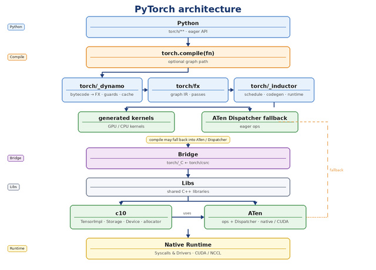

# architecture

## Role

This module is the **bird’s-eye map** of a normal PyTorch source tree. Before diving into
Dispatcher, compile, or CUDA details, you want a stable mental model of which layer owns
what: Python front-end, optional compile stack, C++ bindings, ATen / c10 libraries, and
the native runtime (CUDA / NCCL / drivers).

PyTorch is deliberately layered so that:

- User code stays in Python (`torch/**`) without caring how kernels are selected.
- Device / layout / autograd specializations plug in through **DispatchKey**, not through
  rewriting every call site.
- Optional stacks (`torch.compile`, CUDA Graphs, distributed) sit *beside* eager rather
  than replacing it.

## How the layers connect

1. **Python** — `torch.nn`, `torch.autograd`, `torch.cuda`, `torch.distributed`, plus
   `torch.compile` when you opt in.
2. **Bridge** — `torch/_C` (extension module) and `torch/csrc/**` (C++ bindings, autograd
   engine glue, c10d, CUDA helpers).
3. **Libs** — **ATen** (ops + Dispatcher + native kernels) and **c10** (TensorImpl,
   Storage, Device, DispatchKey, CUDACachingAllocator).
4. **Runtime** — CUDA driver / runtime, cuDNN, NCCL, OS syscalls.

Compile is an *optional side path*: `_dynamo` → `fx` → `_inductor` may emit specialized
kernels, but unsupported or dynamic cases fall back into the same ATen Dispatcher that
eager uses.

| Tree | Role |
| --- | --- |
| `torch/` | Python API + compile (`_dynamo` / `_inductor` / `fx`) |
| `torch/csrc/` | C++ bindings, autograd, c10d, JIT, CUDA helpers |
| `aten/` | Op schemas, Dispatcher, `native` / CUDA / cuDNN kernels |
| `c10/` | `TensorImpl`, `DispatchKey`, CUDA allocator / stream / guard |
| `torchgen/` | Codegen from YAML (`native_functions.yaml` → wrappers) |

## What to read next

| Topic | Module |
| --- | --- |
| How an op picks a kernel | [`../c10_aten`](../c10_aten/) |
| `torch.compile` pipeline | [`../compile`](../compile/) |
| GPU memory | [`../allocator`](../allocator/) |
| Capture / replay | [`../cudagraph`](../cudagraph/) |
| Multi-GPU / NCCL | [`../distributed`](../distributed/) |

## References

- [PyTorch 2.0 release blog](https://pytorch.org/blog/pytorch-2.0-release/) — how compile sits next to eager
- [Get started with PyTorch 2.0](https://pytorch.org/get-started/pytorch-2.0/)
- [PyTorch design / overview docs](https://pytorch.org/docs/stable/community/design.html)
- [Extending PyTorch](https://pytorch.org/docs/stable/notes/extending.html) — where custom ops plug into the stack
