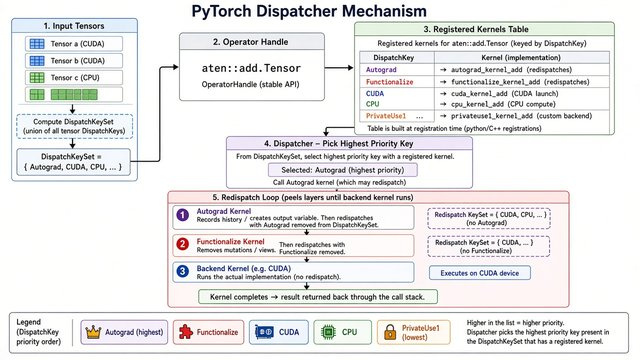
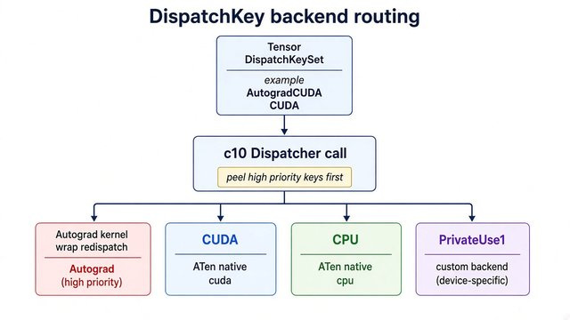
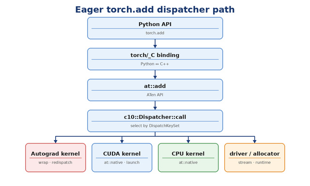
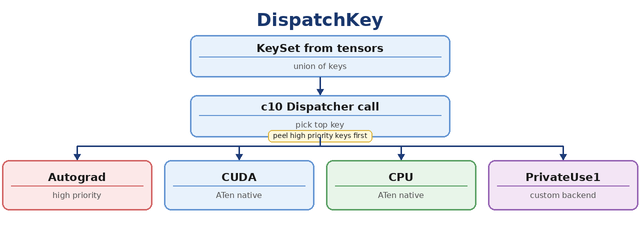

# c10 + ATen (Dispatcher)

## Role

**c10** and **ATen** are the C++ core of PyTorch:

- **c10** — foundational types: `TensorImpl`, `Storage`, `Device`, `DispatchKey`,
  CUDA stream / guard / caching allocator hooks.
- **ATen** — operator library: schemas, the **Dispatcher**, and `native` /
  CUDA / cuDNN implementations.

Every eager `torch.add` / `F.linear` eventually becomes a Dispatcher call that
selects a kernel by **DispatchKeySet**. That same mechanism is how backends
(CPU, CUDA, MPS, XPU, PrivateUse1, …) and “wrap” keys (Autograd, Functionalize,
…) plug in without rewriting Python call sites. Official multi-device writeups
emphasize DispatchKeys as the portable routing layer across devices.

## How dispatch works

1. Tensors carry DispatchKeys (device, layout, autograd, …). Arguments’ keys are
   unioned into a **DispatchKeySet**.
2. The op (`aten::add.Tensor`, …) has a **kernel table** registered at init /
   library load time.
3. Dispatcher picks the **highest-priority** key that has a kernel.
4. Wrap kernels (e.g. Autograd) do bookkeeping then **redispatch** with that key
   masked out (“peel the onion”).
5. A backend kernel (CUDA / CPU / …) finally runs — no further redispatch.









## Boxed vs unboxed

| Path | Use |
| --- | --- |
| Unboxed `Dispatcher::call` | Typed C++ / generated fast path |
| Boxed `Dispatcher::callBoxed` | IValue stack (JIT / some Python edges) |

## Upstream map

| Concern | Files |
| --- | --- |
| Tensor / Storage | `c10/core/TensorImpl.*`, `Storage*` |
| DispatchKey | `c10/core/DispatchKey.h` |
| Dispatcher | `aten/src/ATen/core/dispatch/Dispatcher.*` |
| Operator entries | `aten/src/ATen/core/dispatch/OperatorEntry.*` |
| CUDA kernels | `aten/src/ATen/native/cuda/` |
| Python helpers | `torch/_dispatch/`, `torch.library` |


## Cases

| Case | Idea |
| --- | --- |
| `case_dispatch_dump.py` | print kernel table for `aten::add.Tensor` |

```bash
cd c10_aten
TORCH_DEVICE_BACKEND_AUTOLOAD=0 python case_dispatch_dump.py
```

## References

- [Challenges in PyTorch multi-device integration](https://pytorch.org/blog/pt-multidevice-integration/) — DispatchKey as the routing abstraction
- [Extending PyTorch](https://pytorch.org/docs/stable/notes/extending.html) — custom ops / Dispatcher hooks
- [Custom C++ and CUDA Extensions](https://pytorch.org/tutorials/advanced/cpp_extension.html)
- [PrivateUse1 / custom device backend tutorial](https://pytorch.org/tutorials/advanced/extend_dispatcher.html)
