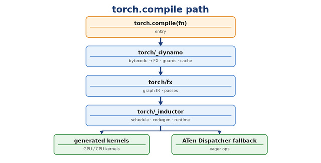

# compile (`torch.compile`)

## Role

`torch.compile` is the **opt-in compiler API** at the center of PyTorch 2.x. It wraps
a function or `nn.Module` and returns a compiled callable that aims to run faster
while staying **additive**: graph breaks / compile failures fall back to the same
eager Dispatcher path, so behavior stays correct.

Official framing ([PyTorch 2.0 blog](https://pytorch.org/blog/pytorch-2.0-release/)):
TorchDynamo + AOTAutograd + PrimTorch + TorchInductor under one user API.



## Pipeline stages (Dynamo → Autograd → Inductor)

Think of one first call (or a call after guards fail) as three cooperating stages:

### 1. TorchDynamo — capture the Python program

| | |
| --- | --- |
| **Job** | Turn a region of Python into an FX graph *safely* |
| **How** | Frame-evaluation hooks (`PEP 523`) intercept bytecode; unsupported /
dynamic Python causes a **graph break** and resumes eagerly |
| **Output** | FX `GraphModule` + **guards** (dtype / device / shape / const assumptions) |
| **Code** | `torch/_dynamo/eval_frame.py`, `torch/_dynamo/` |

Guards decide whether a later call can reuse the compiled artifact. If metadata
drifts, Dynamo recompiles (or breaks) instead of silently running wrong code.

### 2. AOTAutograd — ahead-of-time forward + backward

| | |
| --- | --- |
| **Job** | Trace training graphs once, not on every step |
| **How** | Overload the autograd engine as a tracing autodiff; produce joint or
split forward / backward FX graphs |
| **Why** | Eager autograd builds the backward graph dynamically; AOT records it so
Inductor can optimize **both** directions |
| **Code** | `torch/_functorch/aot_autograd.py`, related Dynamo backends |

Inference can skip much of this path; training is where AOTAutograd pays off.

### 3. PrimTorch / decompositions — shrink the op surface

| | |
| --- | --- |
| **Job** | Canonicalize ~2000 PyTorch ops toward a smaller primitive set (~250) |
| **Why** | Backends / Inductor target primitives instead of every composite op |
| **Code** | decompositions under `torch/_decomp/`, PrimTorch notes in 2.0 materials |

### 4. TorchInductor — schedule + codegen

| | |
| --- | --- |
| **Job** | Turn the FX graph into fast kernels |
| **GPU** | OpenAI Triton (and vendor stacks) with fusion / tiling / autotune |
| **CPU** | C++ / vectorization / oneDNN-style paths where applicable |
| **Fallback** | Ops Inductor cannot handle still call into the ATen Dispatcher |
| **Code** | `torch/_inductor/` |

Optional: Inductor may wrap static regions in **CUDA Graphs** (see
[`../cudagraph`](../cudagraph/)) depending on `mode=`.

### End-to-end call timeline

```text
torch.compile(fn)          # install Dynamo eval hook
fn(*args)                  # 1st call
  ├─ Dynamo: bytecode → FX + guards
  ├─ AOTAutograd: fwd (+ bwd) graphs   [training]
  ├─ Decompose / PrimTorch
  ├─ Inductor: codegen / autotune / optional cudagraph
  └─ run compiled artifact
fn(*args)                  # later call
  ├─ guards OK  → replay compiled path
  └─ guards fail → recompile or graph-break to eager
```

## Runtime modes (`torch.compile(..., mode=...)`)

| Mode | Intent | Typical extras |
| --- | --- | --- |
| `"default"` | Balanced compile time vs speed | Core Dynamo + Inductor |
| `"reduce-overhead"` | Cut CPU launch overhead | Favors CUDA Graphs on static regions |
| `"max-autotune"` | Peak kernel performance | Triton autotune + cudagraphs (longer compile) |
| `"max-autotune-no-cudagraphs"` | Autotune without graph capture | Useful when pointer / mutation constraints break cudagraphs |

You can also pass `backend=` / `options=` for finer control (e.g. inductor config).
`fullgraph=True` forces a single graph (errors on graph break) — useful for
debugging capture completeness.

## What this module teaches

- Compile is a **side path** next to eager, not a second runtime.
- Dynamo vs AOTAutograd vs Inductor are different jobs (capture / autodiff /
  codegen).
- Modes trade compile time, autotune, and CUDA Graph aggressiveness.
- Failures should degrade to Dispatcher — same kernels eager would pick.

## Upstream map

| Topic | Path |
| --- | --- |
| Entry | `torch/_dynamo/eval_frame.py`, `torch/__init__.py` (`compile`) |
| Dynamo | `torch/_dynamo/` |
| AOTAutograd | `torch/_functorch/aot_autograd.py` |
| FX | `torch/fx/` |
| Inductor | `torch/_inductor/` |
| C++ helpers | `torch/csrc/dynamo/`, `torch/csrc/inductor/` |

## Cases

- `case_compile_basic.py` — eager vs compile on a tiny MLP (skips if compile unavailable).

```bash
cd compile
python case_compile_basic.py
```

## References

- [PyTorch 2.0 release blog](https://pytorch.org/blog/pytorch-2.0-release/) — Dynamo / AOTAutograd / PrimTorch / Inductor
- [Get started with torch.compile](https://pytorch.org/get-started/pytorch-2.0/)
- [torch.compiler docs](https://pytorch.org/docs/stable/torch.compiler.html)
- [TorchDynamo deep dive (tutorial)](https://pytorch.org/tutorials/intermediate/torch_compile_tutorial.html)
- [Accelerating Generative AI IV](https://pytorch.org/blog/accelerating-generative-ai-4/) — compile + CUDA Graph constraints
- [PyTorch 2.2 blog](https://pytorch.org/blog/pytorch2-2/) — AOTInductor / export-related compile path
- [Accelerating PyTorch with CUDA Graphs](https://pytorch.org/blog/accelerating-pytorch-with-cuda-graphs/) — why `reduce-overhead` / graphs matter
