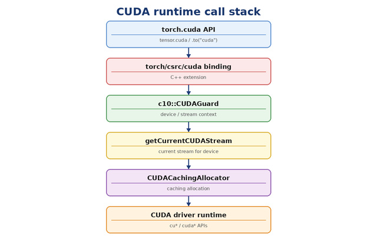
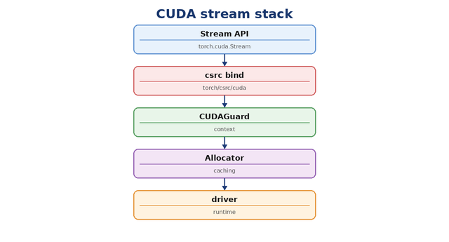

# cuda

## Role

`torch.cuda` is the **device runtime façade**: move tensors to GPU, manage
**streams** / events, and query devices. Under the hood, `torch/csrc/cuda` and
`c10/cuda` install a **CUDAGuard**, pick the current stream, and allocate via
the caching allocator. Peer-to-peer access between GPUs matters for
symmetric-memory / some distributed paths.

This module focuses on streams and device plumbing; memory policy details live
in [`../allocator`](../allocator/), graphs in [`../cudagraph`](../cudagraph/).

## Diagrams






## Cases

| Case | Idea |
| --- | --- |
| `case_stream_mem.py` | explicit stream + memory stats |
| `case_peer_access.py` | print CUDA P2P matrix (for symmetric mem) |

```bash
cd cuda
TORCH_DEVICE_BACKEND_AUTOLOAD=0 python case_stream_mem.py
TORCH_DEVICE_BACKEND_AUTOLOAD=0 python case_peer_access.py
```

## Upstream

| Topic | Path |
| --- | --- |
| Streams | `c10/cuda/CUDAStream.cpp` |
| Guards | `c10/cuda/CUDAGuard.h` |

Allocator: [`../allocator/`](../allocator/).  
Symmetric memory / P2P: [`../distributed/symmetric/`](../distributed/symmetric/).

## References

- [CUDA semantics](https://pytorch.org/docs/stable/notes/cuda.html)
- [Accelerating PyTorch with CUDA Graphs](https://pytorch.org/blog/accelerating-pytorch-with-cuda-graphs/)
- [CUDA Stream semantics (tutorial / docs)](https://pytorch.org/docs/stable/generated/torch.cuda.Stream.html)
