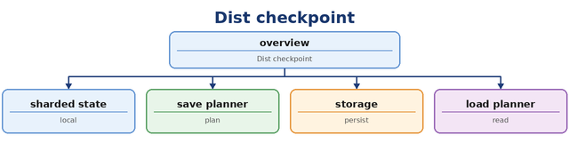

# checkpoint — Distributed checkpoint

`torch.distributed.checkpoint` saves/loads **sharded** state dicts so rank0 need not gather the full model.

**Next cases to add:** save/load a tiny sharded Linear.

## Reference

- [Distributed Checkpoint](https://pytorch.org/docs/stable/distributed.checkpoint.html)
