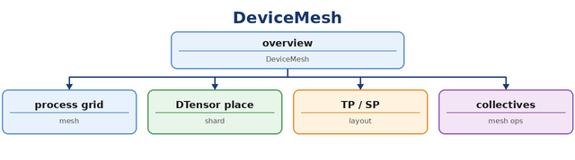

# device_mesh — DeviceMesh & DTensor

`DeviceMesh` describes a multi-dimensional process grid. **DTensor** places shards/replicas on that mesh for tensor / sequence parallel layouts.

**Next cases to add:** 1D mesh shard a weight; compare to manual `AllGather`.

## Reference

- [DeviceMesh](https://pytorch.org/docs/stable/distributed.html#devicemesh)  
- [DTensor](https://pytorch.org/docs/stable/distributed.tensor.html)
