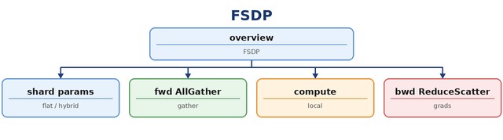

# fsdp — Fully Sharded Data Parallel

FSDP shards parameters, gradients, and optimizer state across ranks.

| Phase | Collective | Meaning |
| --- | --- | --- |
| Forward | AllGather | assemble params for the layer, then free |
| Backward | ReduceScatter | reduce grads and keep only local shard |

Builds directly on [`../collectives/`](../collectives/) (`AllGather` + `ReduceScatter`).

**Next cases to add:** tiny Linear FSDP wrap vs DDP AllReduce traffic comparison.

## Reference

- [PyTorch FSDP](https://pytorch.org/docs/stable/fsdp.html)  
- [Getting Started with FSDP](https://pytorch.org/tutorials/intermediate/FSDP_tutorial.html)
