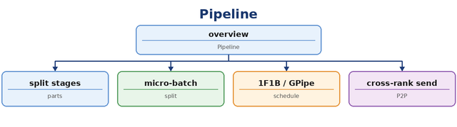

# pipelining — Pipeline parallelism

Split a model into stages across ranks; schedule micro-batches (GPipe / 1F1B) with `torch.distributed.pipelining`.

**Next cases to add:** 2-stage Sequential pipeline on 2 GPUs.

## Reference

- [Pipeline Parallelism](https://pytorch.org/docs/stable/distributed.pipelining.html)
