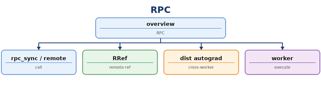

# rpc — RPC & distributed autograd

`torch.distributed.rpc` runs functions / modules on remote workers (`rpc_sync`, `remote`, `RRef`) and can pair with **distributed autograd**.

**Next cases to add:** 2-process `rpc_sync` add; remote Linear forward.

## Reference

- [RPC tutorials](https://pytorch.org/tutorials/intermediate/rpc_tutorial.html)  
- [Distributed autograd](https://pytorch.org/docs/stable/rpc.html#distributed-autograd-framework)
