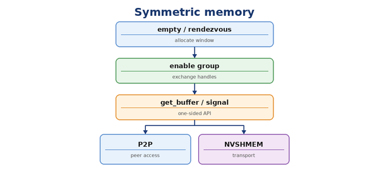
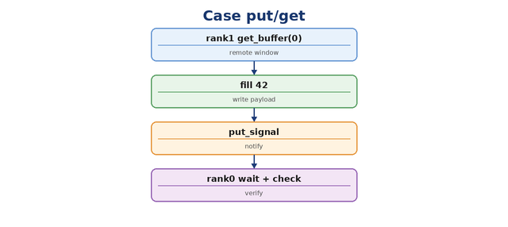

# symmetric — Symmetric Memory

Learn **one-sided** multi-GPU memory (PGAS-style) next to classic NCCL collectives.

Collectives (`AllReduce`, …) are two-sided: every rank enters the same op.  
**Symmetric memory** maps a buffer on every rank into a shared window so a rank can `put`/`get` peer memory and sync with **signals**, often via **CUDA P2P / NVSHMEM**.

PyTorch API: `torch.distributed._symmetric_memory` (and `_SymmetricMemory` in c10d).

## Mental model




| Piece | Role |
| --- | --- |
| `enable_symm_mem_for_group` | turn on symm mem for a process group |
| `symm_mem.empty(...)` | allocate a symmetric tensor |
| `symm_mem.rendezvous(t, group)` | exchange pointers → `_SymmetricMemory` handle |
| `get_buffer(rank, …)` | view a peer (or local) slice |
| `put_signal` / `wait_signal` | lightweight peer sync |
| `barrier` | group sync on the handle |

## Case — `test_put_get.py` / `run_put_get.sh`



2 ranks, NVLink/P2P required:

1. Both allocate + `rendezvous` a float32 buffer of length 1024.  
2. Rank 1 writes `42` into rank 0’s buffer via `get_buffer(0)`.  
3. Rank 1 `put_signal(0)`; rank 0 `wait_signal(1)` and asserts all `42`.

```bash
cd distributed/symmetric
./run_put_get.sh
```

If P2P is missing or the backend is unavailable, the case prints `SKIP`.

## When to use it

| Pattern | Prefer |
| --- | --- |
| Standard DP gradient sync | NCCL `AllReduce` ([collectives/](../collectives/)) |
| Custom low-latency peer exchange / fused gather-matmul | Symmetric memory |
| GPU-initiated comm inside long kernels | NVSHMEM-style backends |

## Reference

### Official / NVIDIA

- [NVSHMEM Introduction](https://docs.nvidia.com/nvshmem/api/introduction.html) — PGAS, one-sided put/get, GPU-initiated communication  
- [NVSHMEM API docs](https://docs.nvidia.com/nvshmem/api/)  
- [OpenSHMEM](http://openshmem.org/) — community PGAS standard NVSHMEM builds on  
- PyTorch source: `torch/distributed/_symmetric_memory/` (upstream tree)  
- Upstream tests: `test/distributed/test_symmetric_memory.py`

### Blogs & deep dives

- [NVIDIA Magnum IO / NVSHMEM / GPUDirect overview](https://developer.nvidia.com/magnum-io)  
- Search NVIDIA Technical Blog for “NVSHMEM” / “GPU-initiated communication” for strong-scaling writeups  
- Chinese notes often under keywords: `SymmetricMemory`、`NVSHMEM`、`单边通信`、`PGAS`（知乎 / 公众号检索）

### Related in this repo

- Collectives contrast: [`../collectives/`](../collectives/)  
- CUDA P2P / streams: [`../../cuda/`](../../cuda/)
