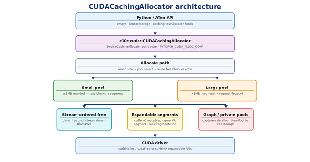

# allocator (`CUDACachingAllocator`)

## What to learn

How PyTorch caches CUDA device memory instead of calling `cudaMalloc` /
`cudaFree` on every tensor: **DeviceCachingAllocator**, small/large **BlockPool**,
stream-ordered frees, **expandable segments** (`cuMemCreate` / `cuMemMap`), and
capture-safe / private pools used by CUDA Graphs.

## Upstream map

| Topic | Path |
| --- | --- |
| Caching allocator | `c10/cuda/CUDACachingAllocator.cpp` / `.h` |
| Config | `c10/cuda/CUDAAllocatorConfig.cpp` (`PYTORCH_CUDA_ALLOC_CONF`) |
| Expandable segments | Note [Expandable Segments] in `CUDACachingAllocator.cpp` |
| Python API | `torch/cuda/memory.py` (`memory_stats`, `empty_cache`, `_set_allocator_settings`) |

## Architecture



### Core pieces

| Piece | Role |
| --- | --- |
| DeviceCachingAllocator | Per-device caching state; allocate / free / empty cache |
| Small / large pool | ≤1MB vs >1MB rounding and segment policy |
| Stream-ordered free | Keep blocks until the allocating stream has completed |
| Expandable segments | Grow one VA segment with `cuMem*` instead of many `cudaMalloc` slabs |
| Graph / MemPool | Private pools so captures see stable addresses |

Enable expandable segments (process start or before heavy allocs):

```bash
export PYTORCH_CUDA_ALLOC_CONF=expandable_segments:True
# or in-process (when supported):
# torch.cuda.memory._set_allocator_settings("expandable_segments:True")
```

## Cases

| Case | Idea |
| --- | --- |
| `case_caching_stats.py` | allocate / free / `empty_cache`; print allocated vs reserved |
| `case_expandable_segments.py` | toggle expandable segments; read `memory_stats` keys |

```bash
cd modules/allocator
python case_caching_stats.py
PYTORCH_CUDA_ALLOC_CONF=expandable_segments:True python case_expandable_segments.py
```
