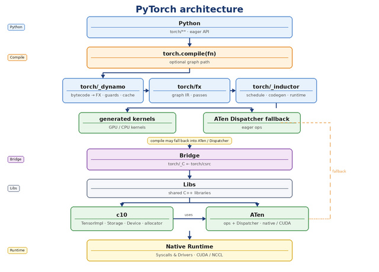

# architecture

Layered map of a normal PyTorch tree: Python → compile → C++ bridge → ATen / c10 → native runtime.

| Tree | Role |
| --- | --- |
| `torch/` | Python API + compile (`_dynamo` / `_inductor` / `fx`) |
| `torch/csrc/` | C++ bindings, autograd, c10d, JIT, CUDA helpers |
| `aten/` | Op schemas, Dispatcher, `native` / CUDA / cuDNN kernels |
| `c10/` | `TensorImpl`, `DispatchKey`, CUDA allocator / stream / guard |
| `torchgen/` | Codegen from YAML |
