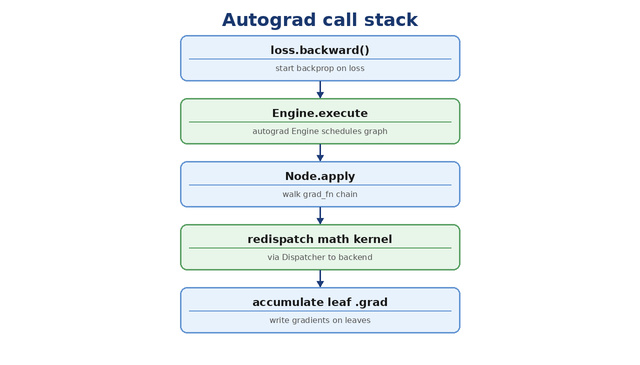
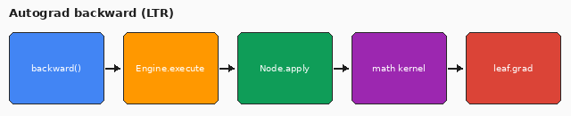
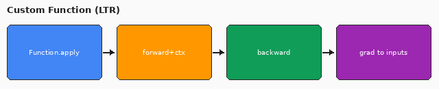

# autograd

## Role

Autograd records a **graph of `Node` / `grad_fn` objects** during the forward
pass when tensors require grad. `loss.backward()` hands control to the
**Engine**, which walks that graph, redispatches math kernels through the
Dispatcher for the backward formulas, and accumulates into leaf `.grad`.

Custom ops plug in via `torch.autograd.Function` (`forward` + `backward` /
`vjp`). Compile-time stacks (AOTAutograd) reuse the same conceptual graph but
trace it ahead of time — see [`../compile`](../compile/).

## Diagrams







## Cases

| Case | Idea |
| --- | --- |
| `case_custom_function.py` | minimal `torch.autograd.Function` |
| `case_grad_fn_chain.py` | print `grad_fn` / `next_functions` |

```bash
cd modules/autograd
TORCH_DEVICE_BACKEND_AUTOLOAD=0 python case_custom_function.py
TORCH_DEVICE_BACKEND_AUTOLOAD=0 python case_grad_fn_chain.py
```

## Upstream

| Topic | Path |
| --- | --- |
| Python API | `torch/autograd/` |
| Engine | `torch/csrc/autograd/engine.cpp` |

## References

- [Autograd mechanics](https://pytorch.org/docs/stable/notes/autograd.html)
- [A Gentle Introduction to torch.autograd](https://pytorch.org/tutorials/beginner/blitz/autograd_tutorial.html)
- [Extending PyTorch with custom Function](https://pytorch.org/docs/stable/notes/extending.html)
- [How Computational Graphs are Constructed in PyTorch](https://pytorch.org/blog/computational-graphs-constructed-in-pytorch/)
- [How Computational Graphs are Executed in PyTorch](https://pytorch.org/blog/how-computational-graphs-are-executed-in-pytorch/)
- [Overview of PyTorch Autograd Engine](https://pytorch.org/blog/overview-of-pytorch-autograd-engine/)
