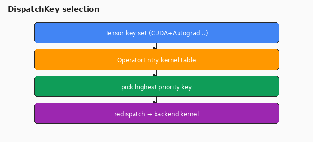

# c10 + ATen

Reading guide + a Dispatcher dump case. Pair with root README dispatcher figures.

## Diagram



## Case

| Case | Idea |
| --- | --- |
| `case_dispatch_dump.py` | print kernel table for `aten::add.Tensor` |

```bash
cd modules/c10_aten
TORCH_DEVICE_BACKEND_AUTOLOAD=0 python case_dispatch_dump.py
```

## Source anchors

| Concern | Files |
| --- | --- |
| Tensor / Storage | `c10/core/TensorImpl.*`, `Storage*` |
| DispatchKey | `c10/core/DispatchKey.h` |
| Dispatcher | `aten/src/ATen/core/dispatch/Dispatcher.*` |
| CUDA kernels | `aten/src/ATen/native/cuda/` |
| Attention | `aten/src/ATen/native/transformers/attention.cpp` |
