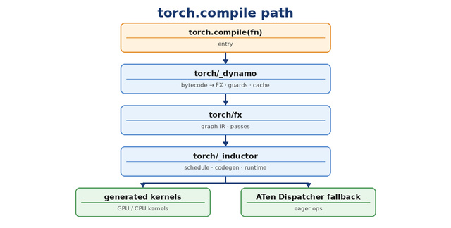

# compile (`torch.compile`)

## What to learn

Where compile sits relative to eager: `_dynamo` → `fx` → `_inductor`, and that fallbacks still hit the ATen dispatcher.

## Upstream map

| Topic | Path |
| --- | --- |
| Entry | `torch/_dynamo/eval_frame.py`, `torch/__init__.py` (`compile`) |
| FX | `torch/fx/` |
| Inductor | `torch/_inductor/` |
| C++ helpers | `torch/csrc/dynamo/`, `torch/csrc/inductor/` |

## Call stack

## Cases

- `case_compile_basic.py` — eager vs compile on a tiny MLP (skips if compile unavailable).
