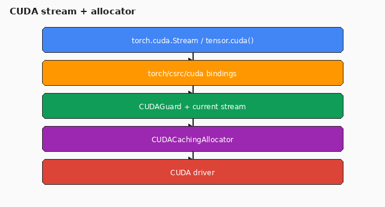

# cuda

## Diagrams




## Cases

| Case | Idea |
| --- | --- |
| `case_stream_mem.py` | explicit stream + memory stats |
| `case_peer_access.py` | print CUDA P2P matrix (for symmetric mem) |

```bash
cd modules/cuda
TORCH_DEVICE_BACKEND_AUTOLOAD=0 python case_stream_mem.py
TORCH_DEVICE_BACKEND_AUTOLOAD=0 python case_peer_access.py
```

## Upstream

| Topic | Path |
| --- | --- |
| Streams | `c10/cuda/CUDAStream.cpp` |
| Allocator | `c10/cuda/CUDACachingAllocator.cpp` |
| Guards | `c10/cuda/CUDAGuard.h` |

See also [`../distributed/symmetric/`](../distributed/symmetric/).
