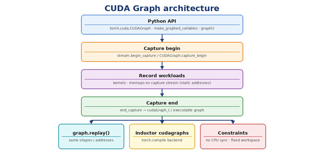

# cudagraph (`torch.cuda.CUDAGraph`)

## What to learn

How CUDA Graph capture records a static GPU workload once and replays it with
`graph.replay()`, including constraints (fixed addresses / shapes, no unexpected
CPU sync) and how Inductor can emit cudagraphs under `torch.compile`.

## Upstream map

| Topic | Path |
| --- | --- |
| Python API | `torch/cuda/graphs.py`, `torch.cuda.graph`, `make_graphed_callables` |
| C++ / bindings | `torch/csrc/cuda/Graph.cpp`, `CUDAGraph.h` |
| Inductor | `torch/_inductor/cudagraph_trees.py`, cudagraph partitioning |

## Architecture

## Cases

- `case_cudagraph_basic.py` — capture a tiny CUDA MLP once, replay, compare to eager (skips if no CUDA).
