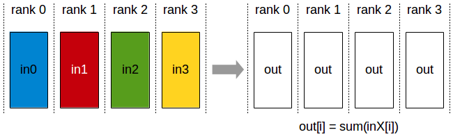
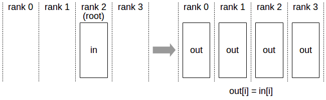
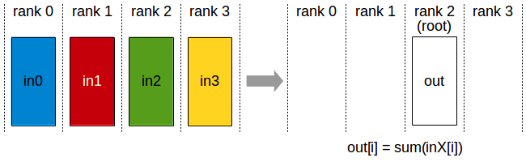
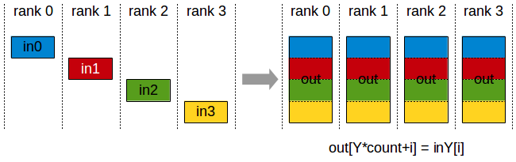
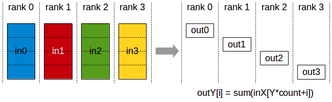
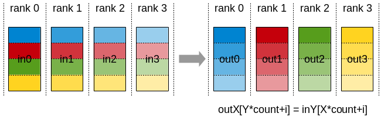
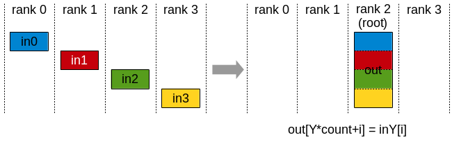
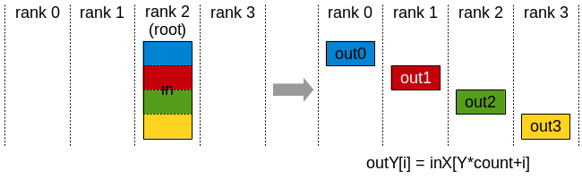

# distributed — NCCL collectives

Eight 8-rank smoke tests, one per NCCL collective. Diagrams below are from the **NVIDIA NCCL User Guide** (no watermark). Layout and expected values match each `test_*.py`.

## How to run

```bash
cd modules/distributed
./run_allreduce.sh
./run_broadcast.sh --N 4096 --root 2 --dtype float16
```

- Needs 8 GPUs. `NPROC_PER_NODE` defaults to 8.
- `torchrun` injects `RANK` / `WORLD_SIZE` / `LOCAL_RANK`. Backend defaults to NCCL.
- Every rank must enter the same collective with the same length and dtype.
- `root` / `src` / `dst` are **rank ids**, not CUDA device ids.
- Each `run_*.sh` uses a different default `MASTER_PORT` (29500–29507).

**Rules that catch most hangs:** all ranks call the collective; count and dtype match; `root` is a logical rank.

---

## 1. AllReduce — `test_allreduce.py` / `run_allreduce.sh`



*Source: [NCCL Collective Operations — AllReduce](https://docs.nvidia.com/deeplearning/nccl/user-guide/docs/usage/collectives.html#allreduce)*

Reduce across all ranks (sum / min / max / …), then leave the **full** result on every rank.

| | |
| --- | --- |
| Check | `out[i] = in0[i] + … + in7[i]` |
| Case input | constant `rank + 1` on every element |
| Expected | every rank sees `36` |
| Typical use | DDP gradient sync |
| API | `dist.all_reduce` / `ncclAllReduce` |

---

## 2. Broadcast — `test_broadcast.py` / `run_broadcast.sh`



*Source: [NCCL Collective Operations — Broadcast](https://docs.nvidia.com/deeplearning/nccl/user-guide/docs/usage/collectives.html#broadcast)*

Copy a length-`N` buffer from `--root` (default `2`) to every other rank.

| | |
| --- | --- |
| Check | every rank ends with `out[i] = in_root[i]` |
| Case input | root fills `in[i] = i + root + 1`; others start at `0` |
| Expected | all ranks match the root buffer |
| Typical use | broadcast initial weights from the main process |
| API | `dist.broadcast` / `ncclBroadcast` |

---

## 3. Reduce — `test_reduce.py` / `run_reduce.sh`



*Source: [NCCL Collective Operations — Reduce](https://docs.nvidia.com/deeplearning/nccl/user-guide/docs/usage/collectives.html#reduce)*

Same reduce math as AllReduce, but only `--root` (default `2`) keeps the result. Non-root buffers are not checked.

| | |
| --- | --- |
| Check on root | `out[i] = in0[i] + … + in7[i]` → `36` |
| Case input | constant `rank + 1` (same as AllReduce) |
| Typical use | parameter-server style gradient reduce |
| Identity | `Reduce + Broadcast = AllReduce` |
| API | `dist.reduce` / `ncclReduce` |

---

## 4. AllGather — `test_allgather.py` / `run_allgather.sh`



*Source: [NCCL Collective Operations — AllGather](https://docs.nvidia.com/deeplearning/nccl/user-guide/docs/usage/collectives.html#allgather)*

Each of `k` ranks holds `N` elements. Concatenate into a `k * N` buffer and deliver that full buffer to **every** rank, ordered by rank id.

| | |
| --- | --- |
| Check | `out[Y * N + i] = inY[i]`, with `inY = Y + 1` |
| Typical use | gather sharded parameters in FSDP / tensor parallel |
| Identity | `ReduceScatter + AllGather = AllReduce` |
| API | `dist.all_gather` / `ncclAllGather` |

---

## 5. ReduceScatter — `test_reducescatter.py` / `run_reducescatter.sh`



*Source: [NCCL Collective Operations — ReduceScatter](https://docs.nvidia.com/deeplearning/nccl/user-guide/docs/usage/collectives.html#reducescatter)*

Reduce first, then split the result into `k` equal chunks. Rank `Y` keeps only chunk `Y`.

| | |
| --- | --- |
| Case input | identical layout on every rank: chunk `Y` filled with `Y + 1` |
| Expected | rank `Y` sees `8 * (Y + 1)` |
| Typical use | FSDP backward, tensor parallel |
| API | `dist.reduce_scatter` / `ncclReduceScatter` |

---

## 6. AlltoAll — `test_alltoall.py` / `run_alltoall.sh`



*Source: [NCCL Collective Operations — AlltoAll](https://docs.nvidia.com/deeplearning/nccl/user-guide/docs/usage/collectives.html#alltoall)*

Each rank’s input is `k * N`, split into `k` segments of length `N`. Rank `Y` sends segment `X` to rank `X`. Rank `X` stores the chunk from rank `Y` in slot `Y`.

| | |
| --- | --- |
| Segment value | `(Y + 1) * 100 + (X + 1)` |
| Check | `outX[Y * N + i] = inY[X * N + i]` |
| Typical use | MoE token routing / expert rearrange |
| API | `dist.all_to_all` / `ncclAlltoAll` |

---

## 7. Gather — `test_gather.py` / `run_gather.sh`



*Source: [NCCL Collective Operations — Gather](https://docs.nvidia.com/deeplearning/nccl/user-guide/docs/usage/collectives.html#gather)*

Same concatenation as AllGather, but only `--root` (default `2`) holds the `k * N` result.

| | |
| --- | --- |
| Check on root | `out[Y * N + i] = inY[i]`, with `inY = Y + 1` |
| Typical use | main process collects per-rank outputs |
| API | `dist.gather` / `ncclGather` |

---

## 8. Scatter — `test_scatter.py` / `run_scatter.sh`



*Source: [NCCL Collective Operations — Scatter](https://docs.nvidia.com/deeplearning/nccl/user-guide/docs/usage/collectives.html#scatter)*

`--root` (default `2`) holds `k * N` elements, splits into `k` chunks of length `N`, and sends chunk `X` to rank `X`.

| | |
| --- | --- |
| Case input | root chunk `X` filled with `X + 1` |
| Expected | rank `X` sees `X + 1` |
| Typical use | main process hands each GPU its shard |
| API | `dist.scatter` / `ncclScatter` |

---

## Useful identities

1. `Reduce + Broadcast = AllReduce`
2. `ReduceScatter + AllGather = AllReduce`

Large-scale training often implements AllReduce as ReduceScatter plus AllGather (less data movement than a naive AllReduce on some topologies).

## Call stack (PyTorch)

```text
torch.distributed.all_reduce / broadcast / …
  → torch/distributed/distributed_c10d.py
  → c10d::ProcessGroup
  → ProcessGroupNCCL
  → ncclAllReduce / ncclBroadcast / …
```

---

## Reference

### Official docs & diagrams

- [NCCL Collective Operations](https://docs.nvidia.com/deeplearning/nccl/user-guide/docs/usage/collectives.html) — diagrams used in this README (`images/*.png`)
- [NCCL User Guide](https://docs.nvidia.com/deeplearning/nccl/user-guide/docs/)
- [PyTorch Distributed Overview](https://pytorch.org/tutorials/beginner/dist_overview.html)
- [PyTorch `torch.distributed` collectives](https://pytorch.org/docs/stable/distributed.html)

### NVIDIA blogs

- [Fast Multi-GPU collectives with NCCL](https://developer.nvidia.com/blog/fast-multi-gpu-collectives-nccl/)
- [Scaling Deep Learning Training with NCCL](https://developer.nvidia.com/blog/scaling-deep-learning-training-nccl/)
- [Massively Scale Your Deep Learning Training with NCCL 2.4](https://developer.nvidia.com/blog/massively-scale-deep-learning-training-nccl-2-4/) (ring vs double binary tree)
- [Understanding NCCL Tuning to Accelerate GPU-to-GPU Communication](https://developer.nvidia.com/blog/understanding-nccl-tuning-to-accelerate-gpu-to-gpu-communication/)

### Tutorials & deep dives

- [03_看懂多卡分布式训练：一文读懂NCCL八大集合通信原语](https://mp.weixin.qq.com/s?__biz=MzkxNDQ5MTI2OA==&mid=2247487813&idx=1&sn=de38842ba5735b88ab837d2512bea005&chksm=c16cc3aef61b4ab8a976f43fdd8d39a861431acc95eca7f3bfe30ab53b8e02b55c7dfc68cd8a&cur_album_id=4770922934775611392&scene=189#wechat_redirect) — Chinese walkthrough of the eight primitives (case design reference)
- [大模型训练八种核心通信源语原理与应用场景（阿里云）](https://developer.aliyun.com/article/1665180)
- [集合通信及其通信原语（博客园）](https://www.cnblogs.com/sys-123456/p/18638725)
- [NCCL源码图解之 allreduce（mubai.tech）](https://mubai.tech/nccl_allreduce)
- [CUDA-MODE 第17课：GPU 集合通信 NCCL](https://mp.weixin.qq.com/s/1QdEJKs4a4u3BepNQ716cQ)
- [Chapter 28: NCCL & Multi-GPU Collective Communication](https://arpanpathak.github.io/gpu-parallel-book/chapters/part7_systems_multi_gpu/ch28_nccl_collectives.html)
- [Demystifying NCCL (arXiv)](https://arxiv.org/html/2507.04786v2)

### Image credit

Collective diagrams under `images/` are copied from the NVIDIA NCCL User Guide for local offline reading. Prefer linking the upstream docs when sharing externally; NVIDIA retains copyright on those assets.
