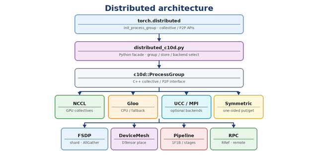
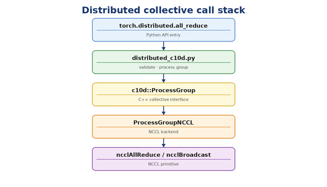

# distributed

## Role

`torch.distributed` is the **multi-process / multi-GPU communication stack**.
User code talks to collectives (`all_reduce`, `all_gather`, …) or P2P; under the
hood c10d selects a **ProcessGroup** backend (typically **NCCL** on NVIDIA GPUs,
**Gloo** on CPU / fallback). Higher-level libraries — FSDP, DeviceMesh /
DTensor, pipeline parallel, RPC, distributed checkpoint — are built *on top of*
those primitives rather than bypassing them.

The
[CUDA Graphs blog](https://pytorch.org/blog/accelerating-pytorch-with-cuda-graphs/)
also notes that NCCL kernels can be captured into graphs so collective launches
stay tightly synchronized across ranks.

## How a collective runs

1. `torch.distributed.all_reduce(...)` in Python.
2. `torch/distributed/distributed_c10d.py` validates tensors, resolves the
   process group, and dispatches into c10d.
3. `c10d::ProcessGroup` abstract API.
4. Concrete backend (`ProcessGroupNCCL`, Gloo, …) issues the library call
   (`ncclAllReduce`, …).
5. Higher patterns (FSDP AllGather / ReduceScatter, pipeline send/recv, RPC)
   compose these ops with autograd / parameter sharding logic.

## Architecture

## Contents

| Subdir | Focus |
| --- | --- |
| [collectives](collectives/) | Eight NCCL collective smoke tests |
| [symmetric](symmetric/) | Symmetric memory put/get + signal (2 GPUs, P2P) |
| [fsdp](fsdp/) | Fully Sharded Data Parallel |
| [device_mesh](device_mesh/) | DeviceMesh / DTensor |
| [pipelining](pipelining/) | Pipeline parallelism |
| [rpc](rpc/) | RPC + distributed autograd |
| [checkpoint](checkpoint/) | Distributed checkpoint |

**Suggested path:** start with **collectives**, then **symmetric** (two-sided vs
one-sided), then FSDP / mesh / pipeline which reuse those primitives.

## Upstream map

| Topic | Path |
| --- | --- |
| Python API | `torch/distributed/` |
| c10d | `torch/csrc/distributed/c10d/` |
| NCCL backend | `ProcessGroupNCCL.*` |
| Symmetric memory | `torch/distributed/_symmetric_memory` |

## References

- [Accelerating PyTorch with CUDA Graphs](https://pytorch.org/blog/accelerating-pytorch-with-cuda-graphs/) — NCCL + graphs
- [PyTorch Distributed overview](https://pytorch.org/tutorials/beginner/dist_overview.html)
- Recent stack evolution: [PyTorch 2.13](https://pytorch.org/blog/pytorch-2-13-release-blog/) / [2.14](https://pytorch.org/blog/pytorch-2-14-release-blog/) release blogs (comms backends, fault tolerance)
