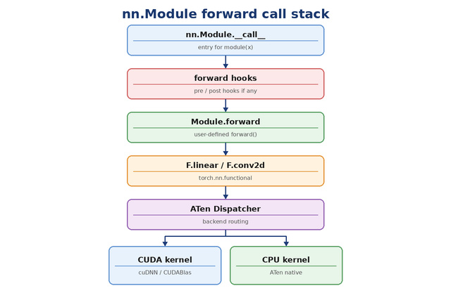
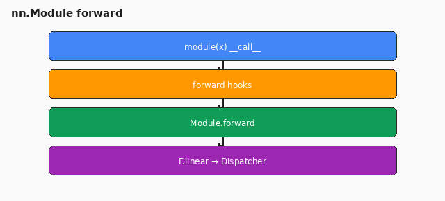
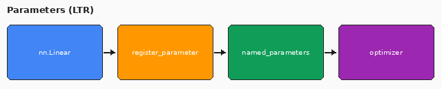

# nn

## Role

`torch.nn.Module` is the **composition and state** layer: parameters, buffers,
submodules, hooks, and `state_dict`. Calling `module(x)` runs `__call__`
(hooks → `forward`). The math usually bottoms out in `torch.nn.functional`
(`F.linear`, `F.conv2d`, …), which are thin wrappers over ATen ops — so the
same Dispatcher / CUDA / cuDNN path applies as for raw tensor ops.

Training loops typically: forward → loss → `backward` → optimizer on
`parameters()`. Checkpointing uses `state_dict` / `load_state_dict`.

## Diagrams







## Cases

| Case | Idea |
| --- | --- |
| `case_linear_forward.py` | `nn.Linear` vs `F.linear` |
| `case_state_dict.py` | `state_dict` round-trip |

```bash
cd modules/nn
TORCH_DEVICE_BACKEND_AUTOLOAD=0 python case_linear_forward.py
TORCH_DEVICE_BACKEND_AUTOLOAD=0 python case_state_dict.py
```

## Upstream

| Topic | Path |
| --- | --- |
| Module | `torch/nn/modules/module.py` |
| Functional | `torch/nn/functional.py` |

## References

- [nn.Module docs](https://pytorch.org/docs/stable/generated/torch.nn.Module.html)
