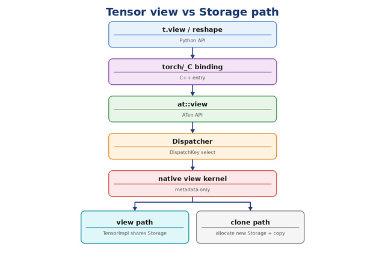
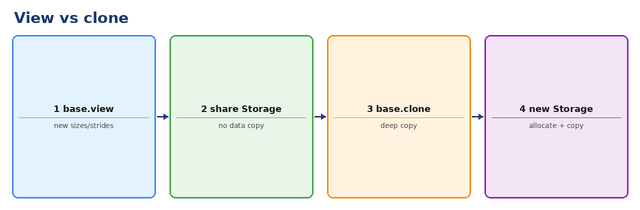
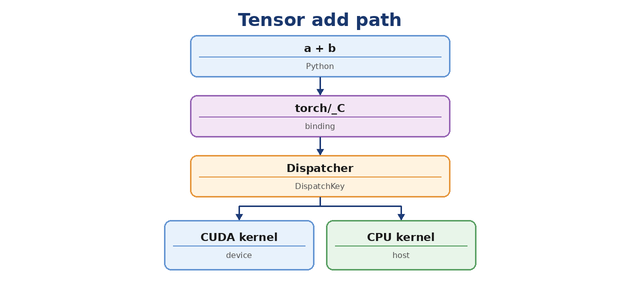

# tensor

## Role

`Tensor` is the user-facing value type; under it, **`TensorImpl` + `Storage`**
own metadata (sizes, strides, dtype, device) and the raw data buffer. Many
“shape” ops (`view`, `transpose`, `expand`) only rewrite metadata and **share
Storage**; `clone` / `contiguous` allocate a new buffer when needed. Understanding
this split explains both performance (zero-copy views) and aliasing bugs.

Arithmetic still goes through the **Dispatcher** (`a + b` → `aten::add`), so
device placement of the tensor determines which backend kernel runs.

## Diagrams







## Cases

| Case | Idea |
| --- | --- |
| `case_view_copy.py` | view shares Storage; clone does not |
| `case_stride_contiguity.py` | transpose strides / contiguous() |

```bash
cd modules/tensor
TORCH_DEVICE_BACKEND_AUTOLOAD=0 python case_view_copy.py
TORCH_DEVICE_BACKEND_AUTOLOAD=0 python case_stride_contiguity.py
```

## Upstream

| Topic | Path |
| --- | --- |
| TensorImpl | `c10/core/TensorImpl.h` |
| Shape ops | `aten/src/ATen/native/TensorShape.cpp` |

## References

- [Tensor views / contiguous docs](https://pytorch.org/docs/stable/tensor_views.html)
